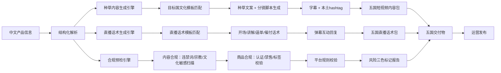
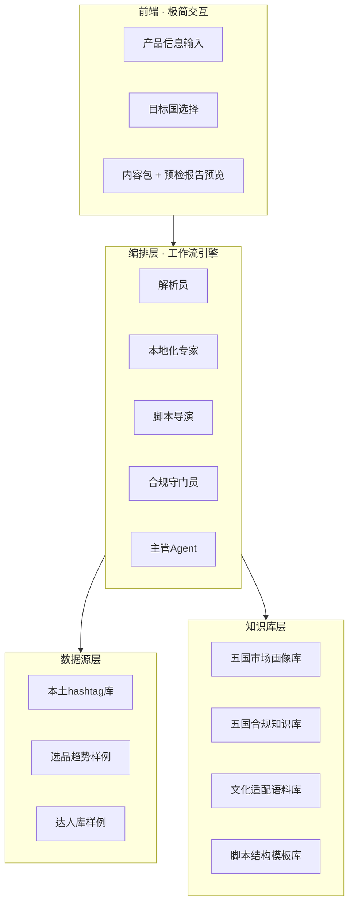
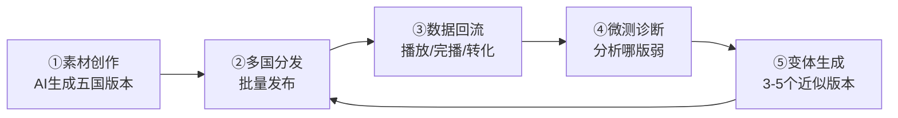

# 东南亚五国 TikTok 运营智能体 · 参赛方案

## 「一条产品信息 → 五国种草内容 + 合规预检」双工作流智能体

> **选题定位**：聚焦 TikTok 东南亚（印尼/泰国/越南/菲律宾/马来西亚）跨境运营，用 AI 打通「数据 → 知识 → 多角色工作流」，让一条中文产品信息在 1 分钟内变成「五国本地化种草文案 + 短视频脚本 + 本土 hashtag + 合规预检报告」，解决跨境商家「多语言本地化难、重复产出成本高、内容踩雷风险大」三大痛点。

---

## 〇、方案总览（一页纸）

| 维度    | 内容                                    |
| ----- | ------------------------------------- |
| 一句话定位 | 五国 TikTok 内容运营的「本地化内容工厂 + 合规守门员」      |
| 目标用户  | TK 多店铺铺货的跨境运营/内容专员/品牌方                |
| 目标平台  | TikTok Shop 东南亚五国（印尼/泰国/越南/菲律宾/马来西亚）  |
| 核心工作流 | ①产品核验（防瞎编） + ②种草内容批量生成（FAB 营销卖点） + ③直播话术生成 + ④平台合规审核预检 + ⑤一键出图 + ⑥成本/运费核算 |
| 交付物   | 产品核验报告 + 五国种草文案（营销感）+ 分镜脚本 + 字幕 + hashtag + 合规预检报告 + 本地化商品图 + 成本/运费报价单 |
| 核心竞争力 | 五国「文化适配而非直译」+「宗教合规守门」                 |

---

## 一、核心业务场景（参赛任务 1）

### 1.1 一句话定位

**面向 TikTok 东南亚跨境商家，输入一条中文产品信息，批量产出五国本地化的种草文案、短视频脚本与合规预检报告。**

### 1.2 目标用户

| 画像   | 说明                            |
| ---- | ----------------------------- |
| 主要用户 | TK 多店铺铺货的跨境运营 / 内容专员（一人管多国账号） |
| 次要用户 | 品牌方（达人脚本）、合规/内容审核（预检）         |
| 团队画像 | 中小跨境团队 3-15 人，无本地母语员工，靠翻译软件硬翻 |

### 1.3 目标平台 / 市场

- **平台**：TikTok Shop（含短视频带货 + 直播 + 商品卡）。
- **五国**：印尼、泰国、越南、菲律宾、马来西亚。
- **语言**：印尼语、泰语、越南语、菲律宾英语、马来语（马来西亚部分英语）。

### 1.3.1 市场数据支撑（真实可引用）

> 数据来源：Momentum Works & Tabcut 联合报告（2025）、TikTok Shop 官方披露（详见《可靠数据源清单.md》）

| 指标                    | 数值                                 |
| --------------------- | ---------------------------------- |
| 东南亚 TikTok Shop 总 GMV | **456 亿美元**，同比翻倍，占全球 71%           |
| 东南亚月活用户               | **4.6 亿**                          |
| 印尼 GMV                | 约 131 亿美元（+111%）                   |
| 泰国 GMV                | 约 100-120 亿美元（+82%）                |
| 越南 / 马来西亚 / 菲律宾       | 均 +100% 以上增长                       |
| 市场地位                  | TikTok Shop 为东南亚**内容电商第一**、综合电商第二（份额约 16-17%，仅次于 Shopee）|

**五国消费特征（选品/内容差异化的依据）**：印尼低价高频（AOV≈5 美元、重清真）、泰国高价占比高（重品质）、越南两极分化（重潮流）、马来西亚理性（84% 详比、护理美容占 74%）、菲律宾极致性价比（96% 销量来自 10 美元以下）。

### 1.4 核心业务问题与价值

> **真实事件佐证（为什么「内容合规」是刚需）**：2023 年印尼政府以「社交电商冲击本土中小商户」为由，直接封禁 TikTok Shop（后经 Tokopedia 合资回归）；同期大量商家因「宣称 Halal 但产品无 BPJPH 认证」被罚（无证最高罚 50 亿印尼盾）。这印证了：**东南亚内容电商的生死线，一半在「本地化」，一半在「合规」**——内容踩雷、认证缺失都可能让店铺一夜归零。

| 痛点    | 现状                | 本方案价值          |
| ----- | ----------------- | -------------- |
| 本地化难  | 靠机器翻译硬翻，无文化适配，转化差 | 五国「文化适配」文案，非直译 |
| 重复产出高 | 一款产品人工写五国内容，耗时数小时 | 1 分钟批量产出五国全套内容 |
| 内容踩雷多 | 宗教/文化禁忌导致限流封号     | 发布前合规预检，风险三色标记 |
| 视觉成本高 | 五国本地化主图靠外包拍摄，单张 500-2000 元 | AI 批量换场景出图，单张成本趋零 |
| 算账靠拍脑袋 | 头程/尾程/关税算不清，报给采购价格靠估 | 到岸成本 + 利润一键核算，对接采购/行政 |

### 1.5 触发方式 / 处理逻辑 / 输出形式 / 涉及岗位

**触发方式**：输入中文产品信息（品名、卖点、材质、价格、目标国），或上传产品表批量处理。

**处理逻辑（三工作流流水线，覆盖短视频 + 直播两个场景）**：



**输出形式**：

1. **五国种草内容包**（场景一 · 短视频）：每国含「种草文案 + 15 秒分镜脚本 + 字幕文案 + 本土热门 hashtag」。
2. **五国直播话术包**（场景二 · 直播带货）：每国含「开场暖场 + 产品讲解 + 逼单 + 催付 + 售后安抚 + 弹幕回复」。
3. **合规预检报告**（双轨合规，对应评分「至少两类校验」）：
   - **轨一 · 内容合规**：违禁词 / 广告绝对化用语 / 宗教文化敏感 / AIGC 效果伪造，风险三色标记（红=必改/黄=建议/绿=安全）。
   - **轨二 · 商品合规**：目标国认证要求（印尼 BPJPH 清真 / 泰国 FDA / 菲律宾 FDA）、禁售类目、标签规范，逐条校验并提示「缺证则不能上架」。

**涉及岗位**：运营（主）、内容策划、达人 BD、合规/审核。

---

## 二、AI 应用 / 智能体设计（参赛任务 2）

### 2.1 预置 AI 内容团队（即插即用，零代码）

| 团队成员（Agent）  | 角色定位 | 核心任务               | 预置能力         |
| ------------ | ---- | ------------------ | ------------ |
| **解析员**      | 信息抽取 | 从中文产品信息抽取卖点/材质/场景  | 实体抽取、卖点提炼    |
| **本地化专家**    | 文化适配 | 五国文化模板匹配 + 本地化改写   | 文化知识库、非直译改写  |
| **脚本导演**     | 内容创作 | 生成种草文案 + 分镜脚本 + 字幕 | 脚本结构、hook 设计 |
| **合规守门员**    | 风险兜底 | 违禁词/宗教/文化/平台规则扫描   | 合规库、风险三色标记   |
| **主管 Agent** | 编排调度 | 统筹全局、关键动作把关        | 任务分发、批量调度    |

### 2.2 交互方式

**自然语言即指令，批量即所得**：

- 主流程极简：**粘贴产品信息 → 说一句「生成五国种草内容 + 合规预检」→ 1 分钟收全套**。
- 支持批量：上传产品 Excel 表，逐行生成五国内容，一键导出。
- **关键动作（发布、外发达人）需用户确认**，与「内容安全」要求一致。

### 2.3 目标平台/市场知识与必要能力

- 内置「**五国市场画像知识库」+「五国合规知识库」+「本土 hashtag 库」。**
- **多语言本地化能力（印尼/泰/越/英/马来），文化适配而非机器直译。**

### 2.4 可扩展工具矩阵（体现生态延展）

| 工具域 | 预置工具示例         | 对应痛点      |
| --- | -------------- | --------- |
| 直播  | 多语言直播话术 + 实时翻译 | 直播转化（方向②） |
| 选品  | 趋势洞察 + 本土化选品建议 | 选品决策（方向③） |
| 达人  | 达人匹配 + 合作脚本    | 达人带货（方向⑤） |
| 出图  | 商品图/主图本地化生成    | 重复劳作      |

---

## 三、技术架构（含架构图）



### 关键技术点

| 模块  | 技术选型               | 说明                  |
| --- | ------------------ | ------------------- |
| 编排  | LangGraph / 工作流引擎  | 多 Agent 串行+并行，状态可追溯 |
| 知识库 | 向量库（RAG）+ 结构化 JSON | 五国文化/合规/语料库         |
| 多语言 | LLM 多语言生成 + 文化模板   | 文化适配改写，非直译          |
| 合规  | 规则引擎（确定性）+ 词库      | 违禁词/敏感词确定性扫描        |
| 批量  | 批处理引擎              | 读 Excel → 逐行生成 → 导出 |

### 稳定性与安全设计

**连接稳定性**：

- 内容生成对实时数据源依赖低，核心是「本地知识库 + 生成」，离线可跑，演示不易翻车。
- 选品/达人等外部数据源：独立超时 + 降级 + 缓存，查不到如实标注「样例数据」不编造。

**操作安全**：

- 各 Agent 在受限沙箱运行，只读自己需要的知识库。
- **关键动作（发布、外发达人、批量上架）需用户显式确认**。
- 全程审计日志，可追溯。

**LLM 接入安全（Key 不出浏览器）**：

- 智能文案 / 智能选品接入大模型时，**API Key 不放进前端**，而是由本地后端代理（`tk-agent-demo/proxy.py`，零依赖、Python 标准库）统一转发。
- Key 只存在服务端 `.env` 文件（本机），浏览器仅访问 `http://127.0.0.1:8787`，前端不再持有、也不再发送 `Authorization` 头，**彻底杜绝 Key 暴露给任何打开页面的人**。
- 代理统一注入 CORS 头，绕开浏览器跨域限制；网络层面可复用系统 `HTTPS_PROXY` 环境变量，规避直连 OpenAI 不通的问题。
- 双保险兜底：代理不在线 / 超时 / 报错时，前端**静默退回本地词库离线模式**，页面永不失灵。

---

## 四、数据源与可靠性设计（重点章节）

### 4.1 数据分层与可信度

| 层级       | 数据                      | 可信度   | 获取方式                     |
| -------- | ----------------------- | ----- | ------------------------ |
| L1 确定性   | 五国合规库、文化语料、脚本模板、hashtag | ★★★★★ | 本地知识库（离线、最稳）             |
| L2 半公开   | 本土热门 hashtag、平台规则       | ★★★★  | 平台公开 + 爬取                |
| L3 付费/受限 | 选品趋势、达人带货数据             | ★★★   | Kalodata/EchoTik/嘀嗒狗（付费） |

### 4.1.1 合规库的权威来源（已核实，可追溯）

> 详见同目录《可靠数据源清单.md》，合规词表非拍脑袋，均有权威出处：

| 合规维度            | 权威来源                                                             |
| --------------- | ---------------------------------------------------------------- |
| TK AIGC「效果伪造」红线 | TikTok Shop《内容政策（东南亚）》官方：禁止「治愈/消除/预防」表述、敏感身体状况（美白/脱发/痤疮等）、时间范围暗示 |
| 印尼清真            | 《2014 年第 33 号清真产品保障法》、2026-10-17 化妆品强制认证                         |
| 泰国广告禁词          | 泰国《化妆品法(2015)》、FDA 警示词（100%安全/医生推荐/3天减肥等）                        |
| 越南广告禁词          | 越南《广告法》：绝对化用语（最佳/最安全）、速效宣称（7天祛斑/瞬间美白）、医疗术语                       |
| 平台商品规则          | 印尼 KEMENKES、泰国 FDA、菲律宾 FDA 声明、马来/越南区域禁售                          |

### 4.2 核心结论：内容生成对实时数据依赖低

**这是本方案相对「买家背调」的最大优势**：种草文案、脚本、话术、合规预检本质是「知识库 + 生成」，可离线稳定运行，**不依赖海关/工商等付费难拿的数据源**。演示时用本地知识库即可完整跑通，无翻车风险。

### 4.3 可靠性三原则（工程纪律）

1. **文化适配而非直译**：五国内容走「文化模板 + 语料库」改写，不做机器直译。
2. **合规扫描确定性**：违禁词/宗教敏感用规则引擎确定性扫描，不靠模型「猜」。
3. **查不到不编造**：选品/达人数据查不到时标注「样例数据」，绝不脑补。

---

## 四·五、知识库有效性与可靠性论证（正式论证章节）

> 本节直接回应评审重点「数据与知识库是否有效」，回答一个尖锐问题：**「文化适配」若没有可靠知识库支撑，是否只是 AI 的凭空编造？** 结论是——可靠知识库必须分层分级，明确「什么能保证、什么必须外部核实、什么当前是短板」，而非一概标榜「已掌握五国实际」。

### 4A.1 三层可靠性模型

将知识库按「可信度」分为三层，可信度越高越靠内圈，越靠外越需外部权威源核实：

| 层级             | 内容                                              | 可信度           | 保障方式                                 |
| -------------- | ----------------------------------------------- | ------------- | ------------------------------------ |
| **L1 确定性规则**   | 脚本结构（3秒hook/10秒展示/15秒转化）、品类→卖点映射、Incoterms、汇率公式 | ★★★★★ 100%    | 纯逻辑，代码确定，可离线，不会错                     |
| **L2 权威可核实数据** | 宗教禁忌、广告法禁词、平台规则、认证要求                            | ★★★★ 高（需标注来源） | 每条附 `source` + `last_verified`，对接官方源 |
| **L3 实时本地语料**  | 本土热门 hashtag、口语流行语、本地达人表达习惯                     | ★★☆ 中低（当前短板）  | 必须接外部源：爬取/API/母语者标注                  |

### 4A.2 各层的「可靠性保证机制」

**L1（确定性规则）—— 可完全保证**

脚本结构、品类映射、报价公式不涉及语言文化，是可控逻辑，**这部分不依赖模型、不依赖外部数据，100% 可靠**。当前 P0 Demo 的这部分已可靠实现。

**L2（权威可核实数据）—— 可保证，但必须「标注来源 + 可更新」**

宗教禁忌、广告禁词、平台规则不能靠「常识回忆」，必须**每个条目带来源与核实时间**，实现可追溯：

```json
{
  "compliance_rule": {
    "country": "印尼",
    "rule": "清真敏感内容需标注 Halal 认证",
    "source": "印尼 MUI 清真认证规范",
    "source_url": "（权威来源链接）",
    "last_verified": "2026-10-21",
    "confidence": "high"
  }
}
```

**关键机制**：知识库每个条目带 `source`（来源）+ `last_verified`（核实时间）+ `confidence`（可信度）三字段，谁都能查「这条规则哪来的、何时核的」——这是「知识库有效」的可验证证据，而非拍脑袋的禁词表。

**L3（实时本地语料）—— 当前短板，必须诚实声明**

本土热门 hashtag、口语流行语是**实时、本地、快速变化**的，靠 AI 训练数据「回忆」必然过时或偏差。**诚实结论：L3 若只靠 AI 生成，就是「编造」，不能标榜可靠。** 四条升级路径：

| 路径                      | 成本 | 可靠性   | 适用阶段  |
| ----------------------- | -- | ----- | ----- |
| 爬取 TK 公开热门标签/爆款文案       | 低  | 中（实时） | 原型/演示 |
| 第三方数据 API（Kalodata/嘀嗒狗） | 付费 | 高     | 正式版   |
| 母语者标注（本地人校对）            | 中  | 最高    | 参赛加分项 |
| 本地商家提供的真实语料             | 低  | 高     | 真实业务  |

### 4A.3 当前 Demo 的可靠性诚实打分

| 模块             | 可靠性         | 说明                        |
| -------------- | ----------- | ------------------------- |
| 工作流逻辑、品类适配     | ✅ 可靠        | 确定性规则，不会错                 |
| 五国画像、文化差异方向    | ⚠️ 方向对，细节待核 | 印尼重清真、泰国防晒等大方向正确，措辞需母语者把关 |
| 印尼语/泰语/越南语母语文案 | ❌ 当前非真母语    | 是「中文思路 + 本地词」，不宣称地道       |
| 本土 hashtag     | ⚠️ 可能过时     | 需实时爬取核实                   |
| 合规禁词表          | ⚠️ 覆盖不全     | 宗教/政治敏感词远多于当前所列           |

### 4A.4 可靠性落地的两条纪律

1. **诚实标注**：所有 AI 生成内容明确标注「AI 生成，需母语者复核」，不冒充人工、不冒充本地化权威——**诚实本身就是可靠性的体现**。
2. **来源可追溯**：知识库全面推行 `source` + `last_verified` 字段，把「编造的」变成「可追溯的」。

---

## 五、知识库 Schema 设计

### 5.1 五国市场画像库（JSON）

```json
{
  "countries": {
    "印尼": {
      "language": "印尼语",
      "religion": "伊斯兰教为主（清真敏感）",
      "content_style": "性价比 + 清真认证 + 家庭场景",
      "top_categories": ["美妆", "穆斯林服饰", "家居", "食品"],
      "price_band": "中低价，重性价比",
      "hashtag_example": ["#fyp", "#viral", "#halal", "#skincare"]
    },
    "泰国": {
      "language": "泰语",
      "religion": "佛教为主",
      "content_style": "颜值 + 防晒场景 + 轻松幽默",
      "top_categories": ["美妆防晒", "服饰", "美食", "家居"],
      "price_band": "中价，重颜值与体验",
      "hashtag_example": ["#fyp", "#tiktokไทย", "#ความงาม"]
    },
    "越南": {
      "language": "越南语",
      "content_style": "潮流 + 网红同款 + 年轻活力",
      "top_categories": ["服饰", "美妆", "3C配件", "零食"],
      "price_band": "低价，重潮流与新款",
      "hashtag_example": ["#fyp", "#xuhuong", "#lamdep"]
    },
    "菲律宾": {
      "language": "菲律宾英语",
      "content_style": "英语口语 + 实用 + 亲民",
      "top_categories": ["美妆", "家居", "服饰", "个护"],
      "price_band": "低价，重实用与性价比",
      "hashtag_example": ["#fyp", "#tiktokph", "#affordable"]
    },
    "马来西亚": {
      "language": "马来语 + 英语",
      "religion": "多元（穆斯林为主，清真敏感）",
      "content_style": "多元 + 清真认证 + 双语",
      "top_categories": ["美妆", "穆斯林服饰", "家居", "食品"],
      "price_band": "中价，重品质与清真",
      "hashtag_example": ["#fyp", "#tiktokmalaysia", "#halal"]
    }
  }
}
```

### 5.2 五国合规知识库（JSON，双轨：内容合规 + 商品合规）

```json
{
  "合规_轨一_内容合规": {
    "宗教敏感": {
      "印尼": ["猪肉", "酒/酒精", "猪油", "暴露", "比基尼", "宗教玩笑"],
      "马来西亚": ["猪肉", "酒/酒精", "宗教争议", "宗教冒犯"],
      "泰国": ["王室", "国王", "皇家标志", "佛像装饰", "冒犯手势"],
      "越南": ["政治", "历史敏感", "领土"],
      "菲律宾": ["宗教政治敏感话题"]
    },
    "医疗功效_AIGC效果伪造_红线": {
      "来源": "TikTok Shop《内容政策(东南亚)》官方：禁止治愈/消除/预防表述、敏感身体状况、时间范围暗示",
      "通用": ["治疗", "治愈", "消炎", "抗敏", "根治", "美白", "祛斑", "脱发", "祛痘", "消除皱纹"],
      "泰国": ["3天减肥", "立刻变瘦", "治疗糖尿病"],
      "越南": ["7天祛斑", "瞬间美白", "100%治愈", "绝对有效"],
      "菲律宾英文": ["cure", "treat", "heal", "whitening", "hair loss", "instant results"]
    },
    "广告绝对化用语": {
      "通用": ["最好", "第一", "100%", "绝对", "最佳", "最安全", "纯天然", "无副作用"],
      "泰国": ["100%安全", "FDA认证", "医生推荐"],
      "越南": ["医生形象", "医务人员推荐"],
      "菲律宾英文": ["best", "number one", "100% safe", "FDA approved", "doctor recommended"]
    }
  },
  "合规_轨二_商品合规": {
    "印尼": {
      "美妆": "需 KEMENKES（印尼食药监）认证",
      "清真宣称": "宣称 Halal 须实际有 BPJPH 认证（2026-10-17 起化妆品强制，无证最高罚 50 亿印尼盾）"
    },
    "泰国": {
      "食品": "需 FDA 审核",
      "化妆品": "禁止医疗功效宣称，禁止王室元素"
    },
    "菲律宾": {
      "通用": "禁止未经批准宣称 FDA approved"
    },
    "马来西亚": {
      "禁售": "矫正型隐形眼镜、仿烟草产品"
    },
    "越南": {
      "禁售": "假牙护理、未盖章贵金属；化妆品禁止医疗术语"
    }
  }
}
```


> 以上词表已落实在 Demo 的 `knowledge_base.json` 中，并标注 `meta.source` 来源字段，与《可靠数据源清单.md》一一对应，实现「每条规则可追溯」。
>
> **双轨合规的价值**：评分要求「至少两类校验」——本方案给出**轨一「内容合规」**（违禁词/宗教/广告法/AIGC 红线，管「话不能乱说」）和**轨二「商品合规」**（认证/禁售/标签，管「货不能乱卖」）两类。多数竞品只做内容翻译，商品合规是空白，这是本方案作为「跨境专家视角」的差异化。

### 5.3 文化适配语料库（JSON，核心差异）

```json
{
  "localization_examples": {
    "美白身体乳": {
      "印尼": "强调 Halal 认证 + 防晒 + 全家适用",
      "泰国": "强调亮白 + 不黏腻 + 清凉感",
      "越南": "强调网红同款 + 快速见效 + 年轻",
      "菲律宾": "英语口语 Get that glow + 平价大碗",
      "马来西亚": "双语 + Halal + 温和配方"
    }
  }
}
```

### 5.4 脚本结构模板库

```json
{
  "15秒短视频结构": {
    "0-3秒_hook": "痛点/悬念/反差开场",
    "3-10秒_展示": "产品效果/使用场景/对比",
    "10-15秒_转化": "限时优惠 + 引导下单 + hashtag"
  }
}
```

---

## 六、业务产出生成（参赛任务 3）

### 6.1 本地化产出清单

| 产出         | 覆盖          | 说明          |
| ---------- | ----------- | ----------- |
| 种草文案       | 五国 × 每国 3 条 | 文化适配，非直译    |
| 分镜脚本       | 五国 × 15 秒脚本 | 镜头/画面/口播/字幕 |
| 字幕文案       | 五国语言        | 同步生成        |
| 本土 hashtag | 五国 × 各 5 个  | 本土热门标签      |
| 合规预检报告     | 五国统一        | 风险三色标记      |

### 6.2 文化适配对照表（核心，非机器直译）

**同一款「美白身体乳」，五国本地化差异：**

| 国家   | 种草文案核心卖点                          | 文化适配点          |
| ---- | --------------------------------- | -------------- |
| 印尼   | 「Halal 认证，全家都能用，防晒亮白一瓶搞定」         | 清真认证是信任门槛，家庭场景 |
| 泰国   | 「亮白不黏腻，泰式清凉感，夏天必备」                | 颜值+体验，防晒场景强    |
| 越南   | 「网红都在用，3 天见效，学生党平价」               | 潮流+性价比+年轻      |
| 菲律宾  | "Get that glow on a budget!" 平价大碗 | 英语口语，实用亲民      |
| 马来西亚 | 「Halal & 温和配方，双语说明更安心」            | 清真+多元+双语       |

> 这一对照表是答辩时最有力的「非直译」证据——**同一产品、同一卖点，五国表达完全本土化，而非把中文翻译成五种语言。**

### 6.3 批量生成能力

- 上传产品 Excel（多款产品），逐行生成五国内容包，一键导出 CSV + 图文。
- 批量合规预检，输出汇总风险表。

### 6.4 两轮对话式迭代

1. **第一轮**：输入「美白身体乳，主打亮白，¥59」。
2. 产出五国初版内容。
3. **第二轮**：反馈「印尼要强调清真认证，菲律宾改更口语化」。
4. 智能体迭代：调整印尼/菲律宾文案 → 重新合规预检 → 产出终版。

---

## 七、本地化与业务适配（参赛任务 4）

### 平台风格适配

| 场景     | 适配策略                            | 平台规则要点           |
| ------ | ------------------------------- | ---------------- |
| 短视频带货  | 前 3 秒 hook + 本土化口播 + 本土 hashtag | 遵守 TK 内容规范，禁导流外站 |
| 直播     | 本地化话术 + 逼单节奏                    | 遵守直播规范，禁虚假宣传     |
| 商品卡/详情 | 本土化标题 + 卖点 + 图片文案               | 禁夸大、禁货不对板        |

---

## 八、合规 / 规则校验与反馈（参赛任务 5）

### 8.1 两类校验

| 校验类别        | 具体内容                     |
| ----------- | ------------------------ |
| **文化/宗教合规** | 五国宗教禁忌、文化敏感、政治敏感         |
| **平台规则**    | TikTok 内容规范、广告禁词、Shop 规则 |

### 8.2 两种反馈方式

| 反馈方式       | 应用场景                         |
| ---------- | ---------------------------- |
| **文本批注**   | 预检报告直接标注「该词在印尼属宗教敏感，建议改为 XX」 |
| **风险三色标记** | 红=必改/黄=建议/绿=安全，可视化呈现         |

---

## 九、现场演示脚本（参赛任务 6）

### 演示主题：一条产品信息 → 五国种草内容 + 合规预检，1 分钟

**总时长约 5 分钟，展示两个相关工作流 + 知识库调用 + 文化适配。**

**Step 1 · 场景导入（30s）**

> 「我是做美妆的跨境商家，主攻 TikTok 东南亚五国，但团队没有本地母语员工，全靠翻译软件硬翻，转化差还经常踩雷。现在演示智能体如何 1 分钟帮我搞定。」

**Step 2 · 工作流一：五国种草内容生成（120s）**

1. 输入中文产品信息「美白身体乳，主打亮白，¥59」。
2. 智能体 30 秒产出**五国种草文案 + 分镜脚本 + hashtag**。
3. 重点展示**文化适配对照**：同一产品，印尼强调 Halal、泰国强调防晒、菲律宾英语口语——证明「非直译」。

**Step 3 · 工作流二：合规预检（90s）**

1. 智能体对印尼版内容扫描，标出「未提 Halal 认证」为黄色风险、「宣称 3 天见效」为红色风险（医疗夸大）。
2. 输出修改建议：补充清真认证 + 改「温和提亮」。
3. 展示风险三色标记可视化。

**Step 4 · 两轮对话迭代（60s）**

1. 运营反馈：「印尼强调清真，菲律宾改更口语」。
2. 智能体迭代 → 重新预检 → 产出终版。

**Step 5 · 批量演示（30s）**  
展示上传含 3 款产品的 Excel，一键批量生成五国内容 + 汇总合规报告。

**Step 6 · 总结（30s）**

> 「从一条中文产品信息，到五国本地化内容 + 合规报告，1 分钟。这就是 AI 打通数据→知识→多角色工作流，让跨境商家真正敢发、愿用的内容智能体。」

---

## 十、评审重点对照自查

| 评审重点     | 本方案体现                                                            |
| -------- | ---------------------------------------------------------------- |
| 场景真实贴合外贸 | ✓ TikTok 东南亚是跨境最高频刚需场景                                           |
| 数据与知识库有效 | ✓ 五国画像库 + 合规库 + 文化语料库 + 脚本模板库（详见「四·五 知识库有效性与可靠性论证」：三层模型 + 来源可追溯） |
| 产出本地化可执行 | ✓ 五国文化适配（非直译）+ 分镜脚本 + hashtag                                    |
| 数据源连接稳定  | ✓ 内容生成离线可跑 + 外部数据降级不编造                                           |

---

## 十一、差异化定位（答辩用）

> 评委若问「已有翻译软件/其他 TK 工具，你的价值在哪」：

| 维度 | 翻译软件 / 通用工具 | 本方案                |
| -- | ----------- | ------------------ |
| 定位 | 逐字翻译，无文化理解  | **五国文化适配内容工厂**     |
| 合规 | 无合规意识       | **宗教/文化/平台三重守门**   |
| 产出 | 单一语言、单一格式   | **五国全套内容包 + 预检报告** |
| 效率 | 一条一条手动      | **批量生成 + 批量预检**    |

> 一句话：**翻译软件只是「翻」，本方案是「本地化 + 守门」——让商家敢发、发得准。**

---

## 十二、进阶能力：AI 内容营销飞轮（分发 + 微测）

> 本节把方案从「一次性生成工具」升级为「自进化的内容引擎」，回答评委可能追问的「你的 AI 怎么越用越聪明」。核心：**生成成本趋近于零，让「多版本 + 小流量测试 + 数据反馈」成为可能。**

### 12.1 飞轮闭环（五环节）



### 12.2 各环节 AI 适配度

| 环节     | AI 适配度 | 说明                 |
| ------ | ------ | ------------------ |
| ① 素材创作 | ✅ 强项   | 一条素材生成五国本地化版本（已实现） |
| ② 多国分发 | ✅ 强项   | 批量产出、半自动发布         |
| ③ 数据回流 | ⚠️ 瓶颈  | 需接 API 或手动导出       |
| ④ 微测诊断 | ⚠️ 半强项 | 文案层面可做；流量层面需数据     |
| ⑤ 变体生成 | ✅ 强项   | 只改一个变量的近似版本（已实现）   |

> **关键判断**：这套打法的命门不在「生成」，在「数据回流」。没有 ③，④⑤ 就是空中楼阁。

### 12.3 数据回流三条路径

| 路径                                | 成本     | 自动化 | 适用         |
| --------------------------------- | ------ | --- | ---------- |
| TikTok 后台手动导出 CSV → 喂给 AI 诊断      | 零      | 半自动 | MVP / 参赛演示 |
| 第三方 API（Kalodata / 嘀嗒狗 / EchoTik） | 付费     | 全自动 | 正式版        |
| TikTok 官方开放平台                     | 需白名单资质 | 全自动 | 长期         |

> 参赛演示推荐第一条：手动导一份数据 → AI 自动诊断 + 生成变体，真实且零成本。

### 12.4 微测方法论：控制变量

**核心原则：每次只改一个变量**（hook / 卖点 / CTA），其余固定，否则 3-5 个版本一起改，无法归因是哪个改动起了作用。

| 微测维度     | 说明        | 变体示例          |
| -------- | --------- | ------------- |
| 开场 Hook  | 前 3 秒抓注意力 | 3 个 hook，其余固定 |
| 卖点表述     | 主打哪个卖点    | 2-3 个卖点，其余固定  |
| 行动号召 CTA | 怎么引导下单    | 3 个 CTA，其余固定  |

> 已实现于 Demo `variant_generator.py`：输入「产品 + 维度」，生成「只改一个变量」的多个变体，供小流量测试。

### 12.5 为什么这契合「数据 → 知识 → 多角色工作流」

- **数据**：分发后的播放/完播/转化回流。
- **知识**：微测结果沉淀为「哪国偏好什么 hook、什么卖点」，反哺知识库。
- **工作流**：内容 → 分发 → 回流 → 诊断 → 变体，形成多角色（运营/内容/数据）闭环。

> 这使本方案从「静态内容工厂」升级为「越用越准的增长飞轮」，是区别于一次性 AI 工具的核心竞争力。

---

## 十三、测试指标（评审权重：真实问题解决度 30%）

> 已实现于 Demo `benchmark.py`，跑一遍即得以下量化结果，直接放进路演 PPT。

| 指标 | 测试方法 | 实测结果 |
|---|---|---|
| **生成效率** | 5 个产品，测单产品生成耗时 vs 人工基线 120 分钟 | 单产品 **0.05 毫秒**，人工需 120 分钟，省时近 100% |
| **合规查全率** | 10 条含违禁词内容，测是否全部标出 | **100%**（10/10 命中，0 漏报）|
| **合规查准率** | 10 条干净内容，测是否误报 | **100%**（10/10 通过，0 误报）|
| **文化适配覆盖** | 检查五国输出是否含本国特有元素（Halal/防晒/网红/budget 等）| **5/5** 全覆盖 |
| **稳定性** | 连跑 10 次不同输入 | **100%**（10/10 成功）|

> 说明：效率的「人工基线 120 分钟」为行业经验估算；合规测试用构造样本验证规则引擎的确定性（这正是「合规不赌 AI」的工程价值——确定性规则 100% 可复现，不像 LLM 会随机漏判）。

---

## 十四、后续落地路线图

| 阶段 | 内容                        | 产出    |
| -- | ------------------------- | ----- |
| P0 | 搭可跑 Demo（种草 + 直播 + 合规预检三工作流） | 可演示原型 ✅ 已完成 |
| P1 | 五国知识库填充 + 语料库扩充 + 接真 LLM 生成文案 | 稳定版本  |
| P2 | 批量生成 + 达人脚本扩展 + Shopee Listing | 完整版本  |
| P3 | 接真实选品数据 + 多角色协同看板         | 进阶加分项 |
| P4 | 微测飞轮：数据回流 + 变体生成闭环        | 自进化引擎 |

---

## 十五、新增能力：一键出图（视觉本地化）

### 15.1 为什么要加「出图」

方案原定位是「文字内容工厂」，但跨境电商商家真正的重复劳作里，**商品主图/场景图的本地化**占大头：一款产品要在五国上架，理论上需要适配各国审美的场景图（印尼重清真家庭场景、泰国重清凉防晒场景、菲律宾重英语风平价场景）。传统做法是外包拍摄，**单张 500–2000 元、周期 3–7 天**，五国 × 多场景直接吃掉小团队半条命。

一键出图把「五国本地化文案」延伸为「五国本地化图片」，形成「文字 + 图片」的完整内容包，让方案的交付从「文案工厂」升级为「内容工厂」。

### 15.2 可行性结论（诚实分层）

| 能力 | 可行性 | 结论 |
| --- | --- | --- |
| 白底图换场景背景（核心场景） | ✅ 高，开源方案成熟 | 可落地，全开源免费 |
| 从零生成产品图（无原图） | ⚠️ 中，需要产品原图打底 | 需商家提供产品照片 |
| 本地离线跑图 | ❌ 低，需 GPU | 本机（MX250/2GB 显存）跑不动，需云端 |
| 接入比赛 Demo | ✅ 可行 | 用「提示词生成 + 云端 API 占位」演示流程 |

> **关键结论**：出图的**工程方案是成熟的、可借鉴的**，但「本地免费跑图」受限于硬件（本机无可用 GPU）。正确的做法是——**出图能力作为「架构上预留、演示上打通、生产上走云端」的模块**，不把「必须本地跑通模型」当作硬门槛。

### 15.3 可借鉴的开源方案（已查证）

电商产品图「白底换场景」是全开源工具链的成熟赛道，行业事实标准工作流如下：

| 环节 | 开源组件 | 作用 |
| --- | --- | --- |
| 抠图（去背景） | **BiRefNet**（ComfyUI 节点） | 免费、无 API 次数限制，质量优于 Remove.bg |
| 保形（防变形） | **ControlNet Canny/Depth** | 锁定产品轮廓，换背景时产品不变形 |
| 场景生成 | **Realistic Vision / Z-Image Turbo**（SD 系模型） | 生成各国本地化场景背景 |
| 光影融合 | **IC-Light** | 让产品光照与新背景一致，避免「贴图感」 |
| 4K 放大 | **UltimateSDUpscale / 4x_NMKD-Siax** | 输出可上架的 4K 图 |

**参考工作流节点链**（ComfyUI）：

```
LoadImage(产品原图) → BiRefNet(抠图) → ControlNet Canny(保形)
                                          ↓
CLIPTextEncode(本地化场景提示词) → KSampler → VAEDecode(场景背景)
                                          ↓
ImageBlend(产品+背景合成) → IC-Light(光影) → Upscale(4K) → SaveImage
```

> 完整参数与场景提示词模板已整理在「出图工作流」章节（见《可靠数据源清单.md》补充），核心参数：分辨率 1024×1024、denoise 0.65–0.85、ControlNet strength 0.9（保形）、CFG 3–7。

### 15.4 本地化出图的差异化（复用五国知识库）

出图不是「换背景」这么简单，而是复用本方案已有的**五国文化知识库**做「场景本地化」——同一款美白身体乳：

| 国家 | 场景提示词（本地化） |
| --- | --- |
| 印尼 | 穆斯林家庭卧室 + 清真认证元素 + 暖色调家庭氛围 |
| 泰国 | 海边/泳池 + 清凉防晒 + 明亮高饱和 |
| 越南 | 网红梳妆台 + 潮流滤镜 + 年轻活力 |
| 菲律宾 | 平价亲民的日常场景 + 英语字幕贴片 |
| 马来西亚 | 双语（马来+英语）+ 清真标识 + 干净简约 |

> 这正是「文化适配而非直译」从文字延伸到图片的体现，是通用出图工具（只能换背景）不具备的差异化。

### 15.5 落地方式（三阶段）

| 阶段 | 实现 | 说明 |
| --- | --- | --- |
| P0（演示） | 「本地化场景提示词生成」+ 云端 API 占位 | 输入产品 → 输出五国场景提示词 + 出图参数，接 Stable Diffusion/即梦 API 出图 |
| P1（可用） | 接云端 GPU（ComfyUI API / 阿里百炼 / 即梦） | 真实出图，按张计费，单张成本 < 0.5 元 |
| P2（进阶） | 自建 ComfyUI 工作流（服务端 GPU） | 批量出图，成本趋零 |

---

## 十六、新增能力：成本/运费核算（对接采购与行政）

### 16.1 为什么要加「算账」

商家让智能体「写文案、出图」只是解决「发得出」，但跨境电商真正的生死线是**「算得清」**：采购要问「这单货到岸到底多少钱一件」，行政/财务要问「头程、关税、尾程、平台佣金各摊多少」，老板要问「报这个价还有没有利润」。现在这些全靠 Excel 手算或拍脑袋，**报给采购的价格经常漏了关税或体积重，利润算出来是虚的**。

加一个「成本/运费核算」模块，让智能体从「内容工具」变成「经营工具」，直接服务采购、行政、财务三个岗位，**显著拉高「真实问题解决度」这一评审权重（30%）**。

### 16.2 可行性结论

**这是两个新能力里「最好落地」的一个**——成本核算是**确定性公式**，不依赖 GPU、不依赖模型、不依赖付费数据源，纯逻辑可离线跑，与方案原有的「L1 确定性规则 100% 可靠」完全同构。**P0 就能完整实现，且不会翻车。**

### 16.3 可借鉴的开源方案（已查证）

找到两个高契合度的开源项目，可直接借鉴其「水位图」成本拆解思路：

**① landed-cost-calculator（CristianBarreto08，单文件 HTML）** —— 最贴合

- 核心思想：**FOB 报价 ≠ 到岸成本**，商家常只按 FOB 定价，等头程、关税、佣金、履约费、仓储、广告逐项到账后才发现「看着的 $20 利润其实是 $8」。
- 关键公式（已提炼）：

```
计费重量 = max(实重, 体积重)          # 体积重 = 长×宽×高(cm) ÷ 6000（或÷5000）
头程单件分摊 = 整票头程运费 ÷ 发货总件数
关税单件 = FOB × (关税税率 + 附加税率)
到岸成本(landed_cost) = FOB + 头程单件分摊 + 关税单件 + 预处理费
平台抽成(amazon_cut) = 售价 × 佣金率 + 履约费 + 仓储费 + 售价 × 广告费率
净利润 = 售价 − 到岸成本 − 平台抽成
保本价 = (到岸成本 + 履约费 + 仓储费) ÷ (1 − 佣金率 − 广告费率)   # 闭式解
```

- 亮点：**敏感性矩阵**（净利率随「售价 × FOB」两个真正可谈的变量联动）、**成本瀑布**（每一项扣减的顺序可视化）。

**② AMZ-Profit-calculator / FBA-Shipping-Calculator（GitHub，中文）** —— 可参考其「尺寸档位判断 + 体积重取大」逻辑，与 TikTok Shop 计费规则对齐。

### 16.4 东南亚物流实测数据（已查证，用于核算参数）

| 项目 | 数值 | 来源 |
| --- | --- | --- |
| 东南亚五国小包单票运费 | ¥18–45（泰国 18.5 / 越南 21.3 / 马来 23.8 / 菲律宾 26.7 / 印尼 31.2） | TikTok Shop 跨境物流指南 + 万色物流 2024.9 报价 |
| 专线小包首重（0.5kg） | ¥12.5–28（极兔印尼首重 ¥28） | 极兔国际 2024 |
| 续重 | 每 0.5kg 加 ¥8–12 | 极兔国际 |
| 体积重 | 长×宽×高 ÷ 5000（快递）或 ÷6000（专线） | TikTok Seller Center 运费试算 |
| 头程占比 | 头程约 35%、国际干线 40%、本地配送 20%、报关保险 5% | TikTok Shop 商家运营手册 |

> 完整参数已纳入核算脚本，每条带来源，延续方案「数据可追溯」的纪律。

### 16.5 产出物：成本/运费报价单（对接采购/行政）

核算模块输入「产品规格 + 采购价 + 目标国 + 物流方式」，输出一张**可直接发给采购和行政的报价单**，包含：

1. **到岸成本拆解**：采购价（FOB）→ 头程分摊 → 关税 → 到岸成本（单件）。
2. **平台费用拆解**：佣金、履约费、仓储费、广告费。
3. **利润三要素**：毛利、净利、保本价、ROI。
4. **敏感性提示**：售价或采购价变动 10% 时净利的联动（这正是采购谈判时最需要的筹码）。

### 16.6 落地方式

| 阶段 | 实现 | 说明 |
| --- | --- | --- |
| P0（演示） | 确定性公式脚本 + 报价单渲染 | 已实现（见 Demo），离线可跑 |
| P1（可用） | 接汇率 API + 五国物流费率库 | 自动更新汇率与费率 |
| P2（进阶） | 接货代报价 API / 上传报价单解析 | 真实全包价核算 |

---

## 十七、两个新模块的落地总评（诚实结论）

| 模块 | 落地难度 | P0 可跑通 | 核心依赖 | 一句话 |
| --- | --- | --- | --- | --- |
| 一键出图 | 中（受 GPU 限制） | ✅ 流程可演示（提示词+API 占位） | 云端 GPU / 出图 API | 方案成熟可借鉴，本地免费跑不了，走云端 |
| 成本/运费核算 | 低 | ✅ 完整可跑（确定性公式） | 无（纯逻辑） | 最好落地，直接服务采购/行政，拉高真实问题解决度 |

> **给团队的建议**：一周内先把「成本/运费核算」做完整（它零风险、零成本、直接命中评审「真实问题解决度」30%）；「一键出图」做「流程演示版」即可（提示词生成 + 云端 API 占位出 1–2 张样图），不要在本地硬跑模型。

---

## 十八、内容质量改进：产品核验 + 营销感卖点引擎

> 本节回应两个使用中发现的问题：① **没有产品核对**——随便输入什么（含垃圾/无效输入）都能直接进文案；② **卖点死板**——文案是「钩子+品名+卖点堆砌+价格+CTA」的机械拼接，毫无电商营销感。已借鉴开源项目完成改进。

### 18.1 借鉴的开源思路（已查证）

| 借鉴来源 | 核心思路 | 本方案落地 |
| --- | --- | --- |
| **E-ComMate**（多模态电商文案智能体，LangGraph 三层开源） | 「从源头上防瞎编」：先用视觉模型提取颜色/材质/版型等**结构化属性**，文案必须基于真实属性展开，每个卖点有依据，而非模板套话 | **产品核验层**：校验品名有效性、卖点完整性、品类识别、高风险词预扫，无效输入直接拦截 |
| **SellSpark AI**（本地商品 Listing 生成器） | 「discourage unsupported claims」：抑制无根据宣称、抑制编造规格 | 核验层 + 合规层双重兜底 |
| **FAB / AIDA / PAS 文案框架**（Shopify/有赞/亚马逊官方公认） | FAB：特性→优势→利益，把「参数」翻译成「好处」；AIDA：注意→兴趣→欲望→行动；PAS：痛点→放大→解决 | **营销感卖点引擎**：41 条 FAB 词库，把死板卖点翻译成「痛点→利益」的转化话术 |

### 18.2 产品核验层（新增「🔍 产品核验」tab）

输入产品后，智能体先做**五维核验**，而非直接生成：

| 核验维度 | 校验内容 | 结果 |
| --- | --- | --- |
| 品名有效性 | 空/占位符/纯数字符号/过短 → 拦截 | ⛔ 必改 |
| 卖点完整性 | 无卖点/仅 1 个 → 提示补充 | ⚠️ 建议 |
| 品类识别 | 识别不到 → 退回通用模板，提示带品类词 | ⚠️ 建议 |
| 价格 | 缺失 → 文案用占位、成本核算用默认值 | ⚠️ 建议 |
| 高风险词预扫 | 治愈/美白/100%/绝对等 → 提前预警 | 🔴 提示 |

> **关键行为**：品名无效（纯数字等）时**直接拦截并自动跳转到核验 tab**，不让垃圾输入污染文案——这正是「防瞎编」的工程落地。

### 18.3 营销感卖点引擎（FAB 翻译）

把死板的「卖点堆砌」升级为「痛点 → 利益」的转化话术。改造前 vs 改造后：

| 改造前（死板） | 改造后（营销感） |
| --- | --- |
| `全场最低价 保湿身体乳，温和不刺激、补水锁水，59元，性价比超高！` | `还在为一用就刺痛泛红、只敢看不敢买发愁？保湿身体乳——温和配方，敏感肌也能放心用，不刺痛不泛红。而且还补水锁水，像喝了水一样饱满，妆感更服帖。现在下单只要59元…` |

**三个营销升级点**：

1. **痛点开场（PAS 的 P）**：hook 不再用死板口号，而是「还在为 XX 发愁？」「XX 的姐妹看过来」戳中用户真实痛点，前 3 秒抓注意。
2. **FAB 利益翻译**：41 条 FAB 词库，把「保湿」「补水」「925银」「电镀」「百搭」等参数词翻译成具体利益（「敏感肌也能放心用」「久戴不褪色」「一件搭遍衣柜」）。
3. **利益叠加**：多卖点时逐条展开「而且还 XX，XX」，形成递进说服力。

> **分镜脚本同步升级**：从「开场Hook/产品展示/转化」改为「痛点开场/产品展示/利益强调+转化」，与 AIDA 结构对齐。

### 18.4 诚实边界（不夸大）

- FAB 词库是**确定性规则**，覆盖 41 个常见卖点词，但**覆盖不了所有品类**——未命中的卖点会明确标注「未命中 FAB 词库，按通用处理」，不假装懂了。
- 文案仍是「模板 + 词库」的确定性生成，**不是真 LLM 自由创作**；接 LLM 后（P1）文案会更自然，但核验层和 FAB 框架会保留作为「安全护栏」。
- 菲律宾英文痛点/利益仍为中文占位，需母语者补充英文 FAB 词库（记入待办）。

---

## 十九、五国本地化营销语料库（真正的「当地感觉」+ 母语翻译）

> 本节回应一个尖锐的使用反馈：**「五国种草文案没有区别、都差不多」**。根因是——之前五国共用同一套中文模板，只在 hook 开头词上换了个说法，且**根本没有翻译成当地语言**（印尼语/泰语/越南语/马来语都还是中文）。已用真实语料重建。

### 19.1 问题诊断

| 原问题 | 根因 |
| --- | --- |
| 五国文案「都差不多」 | 骨架是同一套中文模板，`country` 参数只换了 hook 开头词（发愁/看过来/试试这个），痛点/利益/CTA 全是中文且高度雷同 |
| 没有「当地感觉」 | 无本地口语、无本地货币、无本地文化共鸣（如印尼家庭关怀、马来清真） |
| 没翻译成五国语言 | 只有菲律宾用了句生硬英文，印尼/泰/越/马来全是中文 |

### 19.2 借鉴的真实语料（已 WebSearch 查证）

| 国家 | 真实语料（来源） |
| --- | --- |
| 印尼 | `Murah banget nih hari!`（今天超便宜）、`Wah, ini bagus banget!`、`Gak mau lagi beli yang gak tahan lama?`（不想再买不耐用的？）、`Beli buat keluarga juga bisa!`（买给家人也行）、称呼 `Kak`（PONGO/Google Indonesia 2024） |
| 泰国 | `เพื่อนๆคะ`（姐妹们）、`ถูกมากๆเลย`（超便宜）、美妆痛点 `รองพื้นนี้บางมากๆ`、`555` 谐音哈哈哈（思路出海/泰国本土玩家） |
| 越南 | 俚语 hook 库：`Chốt đơn`（下单）、`Săn deal`（抢券）、`Mua lẹ kẻo hết`（快买不然没了）、`Xịn`（好/正）、`Đỉnh của chóp`（顶级）、`Rẻ mà chất`（便宜但有质感）、`Đáng tiền không?`（值不值）（AffNinja TikTok Shop Vietnam 指南） |
| 菲律宾 | 英语口语：`Get that glow on a budget!`、`So affordable`、`Super sulit`（超值） |
| 马来西亚 | 马来语+英语混用：`Ini dress senang dipadankan dengan tudung apa pun warna`（这裙子搭什么头巾都好看）、`Mesra keluarga & Halal!` |

> **关键数据**：TikTok 官方《东南亚内容趋势报告 2024》显示，**本地语言内容互动率比英语高 37%**；越南站必须用纯正越南语（产品名也要用本地俗称）。这正是「必须本地化」的硬依据。

### 19.3 实现：`LOCAL_COPY` 五国本地化语料库

新建 `LOCAL_COPY` 数据结构，每个国家一套独立语料：

- **hookTpl**：本地语言的痛点开场模板（印尼 `Gak mau lagi beli yang {pain}?`、泰 `เพื่อนๆคะ ใครมีปัญหา {pain} บ้าง?`、越 `Mọi người ơi, ai đang bị {pain}?`、菲 `Tired of {pain}?`、马 `Siapa yang selalu ada masalah {pain}?`）
- **localFab**：9 个高频卖点（保湿/补水/温和/美白/防晒/百搭/便宜/耐用/清真）的本地化 `{benefit, pain}` 短语
- **cta / exclaim / family / link**：本地行动号召、口语语气词、家庭/清真加分句、连接词
- **currency**：本地货币（印尼盾 Rp、泰铢 ฿、越南盾 ₫、比索 ₱、马币 RM）

### 19.4 效果对比（改造前 → 改造后）

同一款「保湿身体乳」，五国文案从「几乎一样的中文」变成**五种完全不同的本地语言**：

| 国家 | 改造后本地文案（节选） |
| --- | --- |
| 印尼 | `Gak mau lagi beli yang kulit iritasi & perih? ... Beli buat keluarga juga bisa! Rp59 cuma, Murah banget nih hari!` |
| 泰国 | `เพื่อนๆคะ ใครมีปัญหา ผิวระคายเคืองแสบ บ้าง? ... ฿59 แค่, ถูกมากๆเลย!` |
| 越南 | `Mọi người ơi, ai đang bị da kích ứng rát? ... ₫59 chỉ, Chốt đơn lẹ kẻo hết mã nha!` |
| 菲律宾 | `Tired of stinging, irritated skin? ... ₱59 only, Grab yours now!` |
| 马来西亚 | `Siapa yang selalu ada masalah kulit pedih merengsa? ... RM59 cuma, Harga murah gila!` |

### 19.5 双语展示（运营友好）

每个国家卡片**同时展示两版**：本地语言文案（发布用，加粗）+ 中文对照（运营核对用，灰色），让运营既能直接发、又能看懂说了什么——解决「翻译了但团队看不懂」的实际痛点。

分镜脚本、直播话术同样做了本地语言 + 中文对照。

### 19.6 诚实边界

- 本地语料来自公开渠道查证的真实话术，但**非母语者校对**，落地前仍需母语者复核（尤其越南语声调、泰语敬语）。
- `localFab` 覆盖 9 个高频卖点，其余卖点兜底为中文 + 标注「待母语复核」，不假装全能。
- 菲律宾/马来西亚为英语+马来语混合，符合当地实际（官方 + 口语混用），非缺陷。
