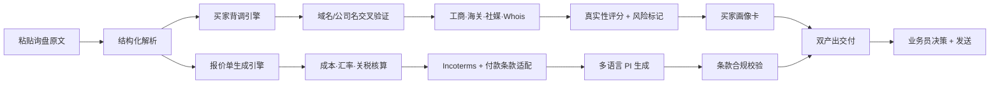
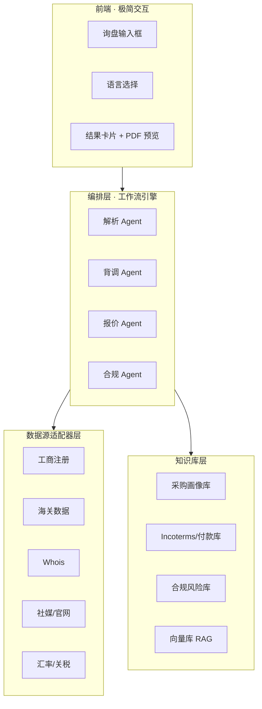

# 外贸 AI 智能体参赛方案

## 「询盘 → 画像 + 报价」双工作流智能体

> **选题定位**：聚焦外贸第一道坎「询盘转化低」，用 AI 打通「数据 → 知识 → 多角色工作流」，让一条原始询盘在 30 秒内变成「可决策的买家画像 + 可直接发送的正式报价单」，业务员从「查资料、做表格」解放到「做判断、谈客户」。

---

## 〇、v2.0 升级说明（参照 Accio Work「AI 商业团队」思路）

> 本版在 v1.0 基础上，借鉴阿里旗下 Accio Work（面向全球电商的 AI Agent 平台）的四大工业级能力，对方案做针对性增强。核心结论：**从「功能工具」升级为「预置 AI 商业团队 + 行业数据底座」的即插即用智能体。**

### 0.1 Accio Work 能力借鉴对照

| Accio Work 核心特征             | 原方案差距            | 本版升级动作                          | 落点章节 |
| --------------------------- | ---------------- | ------------------------------- | ---- |
| 即插即用 Agent 团队（预置技能、无需写代码）   | 偏「架构设计」的开发视角     | 补「预置 Agent 团队清单 + 开箱即用」视角，强调零代码 | 二    |
| 阿里 26 年 B2B 数据 + 100 万商家数据集 | 数据源偏公开通用，缺行业垂直数据 | 补「阿里国际站询盘/RFQ 真实数据源」作核心差异       | 四    |
| 200+ 预置商业工具（选品/谈判/上品/营销）    | 仅 2 个 Agent，生态单薄 | 补「可扩展工具矩阵」，展示生态延展性              | 二、十二 |
| 沙箱环境 + 关键动作需用户批准            | 提了合规但缺「操作安全」     | 补「关键动作人工确认」机制，回应稳定性/安全性         | 三    |

### 0.2 升级后的一页纸定位

\*\*不是做一个「背调工具」或「报价生成器」，而是给外贸商家一支「预置的 AI 业务团队」：业务员用自然语言下指令，团队里的「背调专家」「报价专家」「合规专家」自动协作，30 秒交付出「画像 + 报价」双成果，且接入了阿里 B2B 行业数据底座，做到「开箱即用、数据可信、关键动作可控」。

---

## 一、核心业务场景（参赛任务 1）

### 1.1 一句话定位

**面向 B2B 外贸业务员，输入一条询盘，同时产出「买家背调画像卡」和「本地化报价单（PI）」两份可执行交付物。**

### 1.2 目标用户

| 画像   | 说明                                           |
| ---- | -------------------------------------------- |
| 主要用户 | 每天处理 20+ 条询盘的一线外贸业务员（阿里国际站 RFQ / 独立站 / 展会渠道） |
| 次要用户 | 业务主管（复核高价值询盘）、财务（价格与汇率复核）                    |
| 团队画像 | 中小外贸公司 5-20 人，无专职系统管理员，AI 使用能力弱              |

### 1.3 目标平台 / 市场

- **平台**：阿里国际站（RFQ 为主切入）、独立站询盘、环球资源 / 中国制造网。
- **市场**：美国、德国、中东（阿联酋/沙特）、拉美（墨西哥/巴西），覆盖英语 / 德语 / 西班牙语 / 阿拉伯语四种目标语言。

### 1.4 核心业务问题与价值

| 痛点       | 现状                        | 本方案价值                  |
| -------- | ------------------------- | ---------------------- |
| 询盘转化低    | 手动背调 20-40 分钟/条，凭经验判断买家真假 | 20 秒自动背调，输出真实性评分 + 证据链 |
| 重复人力高    | 报价单手工做 30 分钟/份，币种条款易错     | 一键生成多币种多条款正式 PI        |
| 跨岗位协同难   | 业务/财务/合规数据割裂              | 一条询盘串起业务→财务→合规三角色产出    |
| AI 使用门槛高 | 工具复杂不愿用                   | 极简表单 + 一键产出，零学习成本      |

### 1.5 触发方式 / 处理逻辑 / 输出形式 / 涉及岗位

**触发方式**：粘贴询盘原文（或输入买家公司名 + 邮箱域名），选择目标语言，点「一键分析」。

**处理逻辑（双工作流流水线）**：



**输出形式**：

1. **买家画像卡**：真实性评分（0-100）、采购实力、风险点（证据链接）、推荐跟进策略。
2. **本地化报价单**：正式 PI/Quotation（PDF），多币种多条款，附条款风险批注。

**涉及岗位**：外贸业务员（主）、业务主管（复核）、财务（价格汇率）、合规（条款风险）。

---

## 二、AI 应用 / 智能体设计（参赛任务 2）

### 2.1 预置 AI 商业团队（即插即用，零代码）

参照 Accio Work「预置 Agent 团队」思路，本方案把能力封装成一支**开箱即用的 AI 业务团队**，业务员无需任何技术配置，用自然语言即可指挥：

| 团队成员（Agent）  | 角色定位 | 核心任务        | 预置能力/技能           |
| ------------ | ---- | ----------- | ----------------- |
| **解析员**      | 信息抽取 | 从询盘抽取结构化字段  | 意图识别、实体抽取、多语言理解   |
| **背调专家**     | 买家风控 | 交叉验证买家真实性   | 数据源调用、评分规则、风险标记   |
| **报价专家**     | 商务执行 | 生成本地化报价单    | 币种换算、条款模板、文化适配    |
| **合规专家**     | 风险兜底 | 校验条款与合规风险   | 制裁筛查、禁用词、规则库、认证提醒 |
| **主管 Agent** | 编排调度 | 统筹全局、关键动作把关 | 任务分发、人工确认审批       |

### 2.2 交互方式（对标 Accio「像和队友说话」）

**自然语言即指令，关键动作留人把关**：

- 主流程极简：**粘贴询盘 → 说一句「帮我背调 + 出个德国报价单」→ 30 秒收双成果**。
- 复杂逻辑对用户完全隐藏，输出以「卡片 + PDF」呈现。
- **关键动作（发送报价、付款、批量外发）必须用户点「确认」才执行**——呼应 Accio「关键操作需用户批准」的安全设计，也对应评审「应用与数据源连接稳定」的信任要求。

### 2.3 目标平台/市场知识与必要能力

- 内置「目标市场采购画像知识库」+「Incoterms/付款习惯知识库」。
- 多语言本地化能力（英/德/西/阿），商务语境与文化适配而非机器直译。

### 2.4 可扩展工具矩阵（对标 Accio「200+ 预置工具」，展示生态延展）

核心双工作流之外，预留工具插槽，一键扩展为完整外贸经营套件：

| 工具域   | 预置工具示例               | 对应外贸痛点    |
| ----- | -------------------- | --------- |
| 选品/寻源 | 市场机会扫描、供应商匹配         | 重复人力、选品决策 |
| 谈判    | 供应商比价、非标报价结构化        | 采购协同      |
| 上品/出图 | 多平台 Listing 批量生成、商品图 | 重复劳作（方向②） |
| 营销    | 独立站搭建、广告文案           | 获客        |
| 客服    | 多语言询盘自动回复            | 询盘转化（方向⑤） |

> 说明：本方案聚焦 ①背调 + ④报价 作为核心交付，②③⑤ 以「工具插槽」形式呈现，体现团队生态的**可延展性**，而非一次性堆功能。

---

## 三、技术架构（含架构图）

### 3.1 总体架构



### 3.2 关键技术点

| 模块  | 技术选型               | 说明                    |
| --- | ------------------ | --------------------- |
| 编排  | LangGraph / 工作流引擎  | 多 Agent 串行+并行编排，状态可追溯 |
| 知识库 | 向量库（RAG）+ 结构化 JSON | 采购画像、条款规则、合规词库        |
| 数据源 | 适配器层 + 超时降级        | 每个数据源统一接口，失败降级如实标注    |
| 出图  | 图像生成（可选）           | 报价单 LOGO/水印，商品图扩展     |
| 前端  | 极简 Web 表单          | 零学习成本                 |

### 3.3 稳定性与安全设计（对应评审「数据源连接稳定」+ Accio「沙箱安全」）

**连接稳定性**：

- 每个数据源**独立超时（3s）+ 重试（1 次）+ 降级**：查不到时输出「未检索到，建议人工核实」，绝不编造。
- 结果缓存：同一买家公司 24h 内命中缓存，减少重复调用。
- 关键数据源双备：如海关数据同时接两个供应商，一个失效自动切换。

**操作安全（对标 Accio「沙箱环境 + 关键动作需用户批准」）**：

- 每个 Agent 在**受限沙箱**内运行，只能读自己需要的数据源，不能越界。
- **关键动作白名单**：发送报价、发起付款、批量外发、删除数据——必须用户显式点「确认」才执行，与 Accio「敏感操作需明确授权」一致。
- 全程**操作审计日志**：谁在什么时间做了什么，可追溯，回应用户对 AI 接管商务动作的信任顾虑。

---

## 四、数据源清单

### 4.0 行业数据底座（核心差异化，对标 Accio「阿里 B2B 数据」）

本方案的最大差异点：**不只依赖公开通用数据，而是接入外贸行业垂直数据底座**，让「背调」和「报价」更贴近真实生意：

| 数据底座               | 内容                  | 对方案的价值                        |
| ------------------ | ------------------- | ----------------------------- |
| **阿里国际站询盘/RFQ 数据** | 买家历史询盘行为、采购品类、询盘活跃度 | 背调评分更准——「这个买家是不是真实采购商、采购频率如何」 |
| **买家历史交易画像**       | 平台成交记录、复购率、纠纷记录     | 补充公开数据查不到的交易真实性信号             |
| **行业采购趋势**         | 目标品类在目标市场的热度、价格带    | 报价时给出「目标市场合理价格区间」参考           |
| **100 万级商家/买家数据集** | 行业 benchmark        | 评分模型的训练与校准                    |

> 说明：若参赛环境无法直接调用阿里 B2B API，可退化为「模拟行业数据底座」——用结构化样例数据 + 知识库替代，但架构上预留真实 API 接口，体现「数据源连接稳定」的工程准备。

### 4.1 背调数据源

| # | 数据源          | 用途          | 连接方式                                    | 优先级 |
| - | ------------ | ----------- | --------------------------------------- | --- |
| 0 | 阿里国际站买家数据    | 询盘行为、交易画像   | 阿里开放平台 API（或模拟数据底座）                     | 高★  |
| 1 | 公司官网         | 经营品类、规模、资质  | 爬取 + 解析                                 | 高   |
| 2 | LinkedIn 公司页 | 员工规模、行业、活跃度 | API/爬取                                  | 高   |
| 3 | 各国工商注册       | 存续状态、注册年限   | Companies House / SEC / Handelsregister | 高   |
| 4 | 海关进出口数据      | 采购规模、历史贸易   | ImportGenius / Panjiva 类 API            | 中   |
| 5 | 域名 Whois     | 注册时长、归属     | Whois 查询                                | 中   |
| 6 | 社媒活跃度        | 真实性佐证       | 公开页面抓取                                  | 低   |

### 4.2 报价单数据源

| # | 数据源   | 用途        | 连接方式        |
| - | ----- | --------- | ----------- |
| 1 | 实时汇率  | 多币种换算     | 汇率 API      |
| 2 | 关税税率  | 目标国关税核算   | 关税数据库       |
| 3 | 制裁清单  | 国家/实体筛查   | OFAC / 制裁名单 |
| 4 | 产品成本库 | 成本、MOQ、交期 | 本地/ERP 导入   |
| 5 | 行业价格带 | 目标市场合理报价  | 行业数据底座      |

---

## 五、知识库 Schema 设计

### 5.1 买家采购画像库（JSON）

```json
{
  "market_profile": {
    "country": "德国",
    "language": "德语",
    "buying_style": "重认证、重严谨、决策周期长",
    "communication": "正式称谓、数据驱动、避免夸张",
    "payment_preference": "TT / LC，注重合同条款",
    "price_sensitivity": "低，更重质量与合规",
    "followup_rule": "提供 CE/认证资料，跟进间隔 3-5 天"
  }
}
```

### 5.2 Incoterms / 付款习惯库

```json
{
  "incoterms": {
    "FOB": {"风险转移": "装运港船上", "费用": "卖方承担至装运港"},
    "CIF": {"风险转移": "装运港", "费用": "卖方承担保险+运费"},
    "EXW": {"风险转移": "工厂", "费用": "买方承担全部"}
  },
  "payment_by_country": {
    "美国": ["TT", "LC"],
    "德国": ["TT", "LC"],
    "拉美": ["TT", "分期付款", "DP"],
    "中东": ["TT", "LC", "定金+尾款"]
  }
}
```

### 5.3 合规风险库

```json
{
  "compliance_rules": [
    {"type": "sanction", "check": "国家/实体是否在制裁清单", "action": "标记风险并阻断报价"},
    {"type": "certification", "check": "目标国强制认证（如 CE/UL/FCC）", "action": "批注提醒提供认证"},
    {"type": "clause", "check": "条款是否符合目标国惯例", "action": "风险批注"}
  ],
  "cultural_sensitive": [
    {"country": "中东", "avoid": "涉及宗教/政治敏感表述、猪/酒类相关图"},
    {"country": "德国", "avoid": "夸大宣传、无数据支撑的绝对化用语"}
  ]
}
```

### 5.4 买家真实性评分模型

```json
{
  "scoring_weights": {
    "官网可访问且有完整资质": 25,
    "工商注册存续且年限>3年": 25,
    "LinkedIn 员工规模>50人": 20,
    "海关进出口记录存在": 20,
    "域名注册时长>2年": 10
  },
  "risk_flags": [
    "邮箱域名与公司官网域名不一致",
    "公司注册地与实际发货地不符",
    "要求使用高风险付款方式",
    "新注册域名 + 无可查工商信息"
  ]
}
```

---

## 六、业务产出生成（参赛任务 3）

### 6.1 本地化业务产出清单

| 产出       | 语言/角色覆盖        | 说明              |
| -------- | -------------- | --------------- |
| 买家画像卡    | 中文 + 英文（业务员自用） | 评分 + 证据链 + 跟进策略 |
| 跟进话术     | 英/德/西/阿 四语     | 商务语境 + 文化适配     |
| 正式报价单 PI | 目标语言（2+ 种）     | 多币种多条款          |
| 合规批注     | 文本批注 + 风险标记    | 两类校验两类反馈        |

### 6.2 商务语境与文化适配（非机器直译示例）

**同一句「我们很重视这次合作」，四种本地化：**

| 语言       | 本地化表达                                                                                  | 文化适配点        |
| -------- | -------------------------------------------------------------------------------------- | ------------ |
| 英语（美国）   | "We see strong potential in this partnership and would like to move forward promptly." | 直接、行动导向、效率优先 |
| 德语       | "Wir legen großen Wert auf eine langfristige und verlässliche Zusammenarbeit."         | 严谨、强调长期与可靠   |
| 西班牙语（拉美） | "Para nosotros es un honor iniciar esta relación comercial con ustedes."               | 关系导向、敬语、热忱   |
| 阿拉伯语（中东） | "نحن نتطلع إلى بناء شراكة موثوقة ومستدامة معكم بإذن الله."                             | 信任、关系、宗教语境含蓄 |

### 6.3 批量生成能力

- **批量报价**：上传含多个 SKU 的成本表，批量生成多客户多语言报价单。
- **批量背调**：上传询盘列表，批量产出画像卡（可选扩展）。

### 6.4 两轮对话式迭代

1. **第一轮**：业务员输入「美国客户，做不锈钢水杯，目标价 $2.5」。
2. 智能体产出画像卡 + 首版报价单。
3. **第二轮**：业务员反馈「客户是分销商，起订量要降到 5000 件，改 CIF 条款」。
4. 智能体迭代：重新核算 → 调整条款 → 更新风险批注 → 产出终版 PI。

---

## 七、本地化与业务适配（参赛任务 4）

### 平台风格适配

| 平台/场景        | 适配策略             | 平台规则要点               |
| ------------ | ---------------- | -------------------- |
| 阿里国际站 RFQ 回复 | 结构化报价 + 突出交期/起订量 | 遵守 RFQ 报价规则、避免联系方式违规 |
| 独立站报价        | 正式 PI + 品牌化版式    | 符合国际贸易惯例             |
| 展会/线下        | 一页纸报价卡           | 简洁、可打印               |

---

## 八、合规 / 规则校验与反馈（参赛任务 5）

### 8.1 两类校验

| 校验类别        | 具体内容                              |
| ----------- | --------------------------------- |
| **目标国合规**   | 制裁国家/实体筛查、强制认证提醒（CE/UL/FCC）、关税核算  |
| **平台/合同条款** | Incoterms 正确性、付款方式合规、合同条款风险、文化敏感词 |

### 8.2 两种反馈方式

| 反馈方式     | 应用场景                           |
| -------- | ------------------------------ |
| **文本批注** | 报价单上直接标注风险点（如「目标国需 UL 认证，请确认」） |
| **风险标记** | 画像卡/报价单用红黄绿三色标记风险等级，可视化呈现      |

---

## 九、现场演示脚本（参赛任务 6）

### 演示主题：一条询盘 → 画像 + 报价，30 秒决策

**总时长约 5 分钟，展示两个相关工作流 + 知识库调用 + 多岗位输出。**

**Step 1 · 场景导入（30s）**

> 「我是深圳做不锈钢水杯的外贸业务员，早上收到一条德国客户的 RFQ，现在演示如何用智能体 30 秒完成背调和报价。」


**Step 2 · 工作流一：买家背调（90s）**

1. 粘贴德国买家询盘原文（公司名 + 邮箱域名）。
2. 智能体 20 秒返回**买家画像卡**：真实性评分 82 分、官网+工商+海关证据链、风险标记（无）。
3. 切换展示同一买家的**阿拉伯语**跟进话术，体现文化适配。

**Step 3 · 工作流二：报价单生成（90s）**

1. 输入产品 + 成本 + 目标市场，智能体生成**美元 FOB 正式 PI**。
2. 展示**西班牙语 CIF 版本**，体现多币种多条款本地化。
3. 合规 Agent 自动批注「目标国需 CE 认证」「拉美建议分期付款」——体现两类校验 + 文本批注反馈。

**Step 4 · 两轮对话迭代（60s）**

1. 业务员：「起订量降到 5000 件，改 CIF」。
2. 智能体迭代：重算价格 → 更新条款 → 产出终版 PI。

**Step 5 · 多岗位协同展示（30s）**  
展示财务（汇率复核）、合规（风险批注）两个岗位的输出在同一工作台流转。

**Step 6 · 总结（30s）**

> 「从一条询盘，到可决策的画像 + 可发送的报价单，30 秒完成。这就是 AI 打通数据→知识→多角色工作流，让外贸人真正愿意用的智能应用。」

---

## 十、评审重点对照自查

| 评审重点     | 本方案体现                              | v2.0 增强点             |
| -------- | ---------------------------------- | -------------------- |
| 场景真实贴合外贸 | ✓ 询盘背调 + 报价单是最高频刚需场景               | 以「AI 业务团队」而非「工具」视角呈现 |
| 数据与知识库有效 | ✓ 采购画像库 + Incoterms 库 + 合规库 + 评分模型 | 新增阿里 B2B 行业数据底座      |
| 产出本地化可执行 | ✓ 四语话术 + 正式 PI + 文化适配非直译           | 自然语言驱动，零代码即插即用       |
| 数据源连接稳定  | ✓ 超时降级 + 缓存 + 双备 + 如实标注不编造         | 新增沙箱隔离 + 关键动作人工确认    |

## 十一、与 Accio Work 的差异化定位（答辩用）

> 评委若问「已有 Accio 这类产品，你的价值在哪」，用这一页回应：

| 维度 | Accio Work            | 本方案                           |
| -- | --------------------- | ----------------------------- |
| 定位 | 通用「AI 商业团队」平台，覆盖全电商链路 | **垂直聚焦「询盘→成交」第一公里**，做深做透      |
| 数据 | 阿里 B2B 全域数据           | 背调 + 报价垂直数据，**证据链可追溯、评分可解释**  |
| 交付 | 平台级、需注册使用             | 参赛方案强调**本地化可执行**：四语话术 + 正式 PI |
| 安全 | 沙箱 + 关键动作批准           | 同样遵循，且**全程审计 + 风险三色标记可视化**    |


> 一句话：**Accio 是「宽」，本方案是「深」——在询盘转化这个最高频场景里，把背调 + 报价做到外贸人真的愿用、敢用。**

## 十二、后续落地路线图

| 阶段 | 内容                            | 产出    |
| -- | ----------------------------- | ----- |
| P0 | 搭可跑 Demo（背调 + 报价双工作流，含关键动作确认） | 可演示原型 |
| P1 | 接真实数据源 + 行业数据底座 + 知识库填充       | 稳定版本  |
| P2 | 批量生成 + 多语言扩展 + 工具矩阵插槽         | 完整版本  |
| P3 | 多角色协同看板 + 审计日志                | 进阶加分项 |
